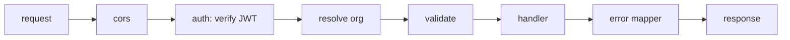

<!-- map: api | sha: <commit this was generated at> | sources: <globs from .map/conventions.md> -->

# Map — API

<!-- Generated by /map. Never hand-edit: the next run overwrites everything
     except the Why column, which is carried over verbatim for unchanged
     endpoints. -->

| | |
|---|---|
| **Framework** | <Express / NestJS / Spring / Rails, and version> |
| **Base path** | <`/api/v1`, or —> |
| **Derived from** | <the route files, or a generated OpenAPI document, with path> |
| **Endpoints** | <n> — <n> GET, <n> POST, <n> PATCH, <n> DELETE |
| **Auth model** | <one line: bearer JWT, session cookie, mTLS — detail below> |

---

## Endpoints

<!-- Sorted by path, then by method. One row per endpoint, no exceptions: a
     complex endpoint points at its handler rather than growing a section.

     Keep cells terse. `Tables` is this map's own discovery — `r` for read,
     `w` for write. `Called from` is transposed from front.Calls by the seam
     pass: leave it empty when generating, and never grep for it yourself. -->

| Method | Path | Auth | Request | Returns | Handler | Tables | Called from | Why |
|---|---|---|---|---|---|---|---|---|
| GET | `/orgs/:id/invitations` | `member` | — | `200 Invitation[]` | `routes/invitations.ts:52` | `invitations` r | | |
| POST | `/invitations` | `admin` | `{email, role}` | `201 Invitation`, `409` if pending | `routes/invitations.ts:14` | `invitations` w, `orgs` r | | rate-limited separately from the rest of the API |
| POST | `/invitations/:id/accept` | public + token | `{token}` | `204` | `routes/invitations.ts:88` | `invitations` w, `users` w | | deliberately unauthenticated — the token *is* the credential |

---

## Cross-cutting

<!-- The conventions a reader needs before they can read a single row above.
     Each one as a fact about this codebase, with the file that implements it. -->

| Concern | How this API does it | Implemented in |
|---|---|---|
| Authentication | <mechanism, where the identity ends up> | `<path>` |
| Authorization | <roles, scopes, and where the check happens> | `<path>` |
| Error envelope | <the exact shape of an error response> | `<path>` |
| Validation | <library, where schemas live, what a failure returns> | `<path>` |
| Pagination | <convention, parameter names, response shape> | `<path>` |
| Rate limiting | <scope and limits, or "none"> | `<path>` |
| Versioning | <strategy, or "none — breaking changes ship in place"> | — |

### Request lifecycle

<!-- The one diagram for this map: the middleware chain a request passes
     through, in order. Capped at ~15 nodes. This is the thing that is most
     expensive to reconstruct by reading code, and the cheapest to draw. -->

---

## Unreferenced

<!-- Endpoints whose transposed `Called from` came out empty. Omit when none.
     `external` in that column means callers live outside this repo and the
     column proves nothing — such endpoints do not belong in this list. -->

| Endpoint | Observation |
|---|---|
| `GET /legacy/users` | no caller in the front map; handler still registered |

---

## Gaps

- <what could not be determined, and the reason>
