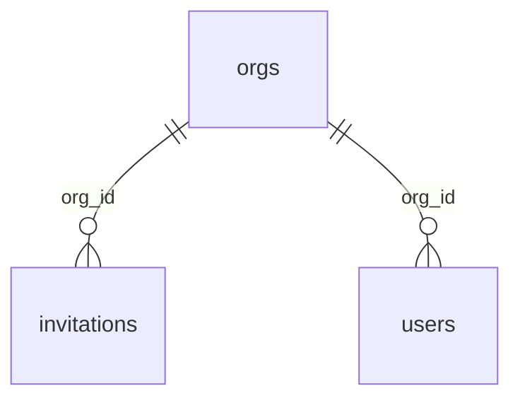

<!-- map: db | sha: <commit this was generated at> | sources: <globs from .map/conventions.md> -->

# Map — Database

<!-- Generated by /map. Never hand-edit: the next run overwrites everything
     except the Why column, which is carried over verbatim for unchanged
     entities. Knowledge that is not about one entity belongs in your notes,
     not here. -->

| | |
|---|---|
| **Engine** | <PostgreSQL 16 / MySQL 8 / SQLite> |
| **Derived from** | <`pg_dump -s`, or the schema file, with its path> |
| **Migration tool** | <tool, directory, latest applied migration> |
| **Tables** | <n> |
| **Enums** | <n> |

---

## Tables at a glance

<!-- Alphabetical. One row per table. Written by / Read by are transposed from
     api.Tables by the seam pass — leave them empty when generating. -->

| Table | Cols | Primary key | Written by | Read by | Why |
|---|---|---|---|---|---|
| `invitations` | 6 | `id` | `POST /invitations`, `POST /invitations/:id/accept` | `GET /orgs/:id/invitations` | expires after 7 days; rows are kept for audit rather than deleted |
| `users` | 11 | `id` | | | |

---

## <Domain cluster, e.g. Identity>

<!-- Cluster tables by domain only if there are more than ~15 of them, and use
     the same clustering as the FK diagram. Otherwise one flat alphabetical
     list of ### sections. Within a cluster, alphabetical. -->

### `invitations`

| Column | Type | Null | Default | Key | Why |
|---|---|---|---|---|---|
| `id` | `uuid` | no | `gen_random_uuid()` | PK | |
| `org_id` | `uuid` | no | — | FK → `orgs.id` ON DELETE CASCADE | |
| `email` | `citext` | no | — | UQ with `org_id` | `citext` so re-inviting with different casing is rejected |
| `role` | `member_role` | no | `'member'` | | |
| `expires_at` | `timestamptz` | no | — | | |
| `created_at` | `timestamptz` | no | `now()` | | |

**Indexes**: <alphabetical; name, columns, unique/partial — or "none beyond the key">
**Checks**: <named check constraints and their condition — or omit the line>
**Triggers**: <name, when it fires, what it does — omit if none. A trigger nobody knows about is the most expensive thing in a schema to rediscover.>

---

## Enums

| Enum | Values | Used by |
|---|---|---|
| `member_role` | `owner`, `admin`, `member` | `users.role`, `invitations.role` |

---

## Relationships

<!-- The one diagram for this map: the foreign-key graph. Capped at ~15 nodes —
     past that, draw one cluster per domain, or drop the diagram and keep the
     table above. A hairball is not a map. -->

---

## Unreferenced

<!-- Tables with no writer and no reader in the api map. Facts, with the obvious
     question attached — not a recommendation to drop them. Omit the section
     when there are none. -->

| Table | Observation |
|---|---|
| `legacy_sessions` | no endpoint reads or writes it; last migration touching it <date> |

---

## Gaps

<!-- Everything this map does not know, and why. Every `?` above appears here.
     A map that claims completeness it does not have is worse than no map. -->

- <what could not be determined, and the reason>
