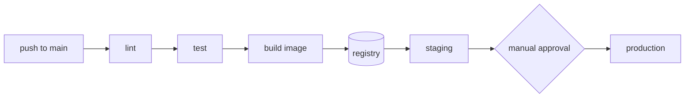

<!-- map: deploy | sha: <commit this was generated at> | sources: <globs from .map/conventions.md> -->

# Map — Deployment

<!-- Generated by /map. Never hand-edit: the next run overwrites everything
     except the Why column, which is carried over verbatim. -->

| | |
|---|---|
| **CI** | <GitHub Actions / GitLab CI, and the workflow files> |
| **Runtime** | <Fly.io / ECS / Kubernetes / a VPS with docker compose> |
| **Registry** | <where images go> |
| **Environments** | <n> |
| **Covered here** | <what of the pipeline actually lives in this repo — say plainly when infrastructure is defined elsewhere> |

---

## Environments

| Env | URL | Deploys from | Trigger | Database | Why |
|---|---|---|---|---|---|
| production | <url> | `main` | manual approval | <instance, and whether migrations run automatically> | |
| staging | <url> | `main` | every push | | shares the production registry; images are promoted, not rebuilt |

---

## Pipeline

<!-- The one diagram for this map: commit → CI → artifact → environment.
     Capped at ~15 nodes. Include the gates, because the gates are what people
     forget. -->

---

## Workflows

| Workflow | File | Triggers | Does | Secrets used |
|---|---|---|---|---|
| `ci` | `.github/workflows/ci.yml` | `pull_request` | lint, test, typecheck | — |
| `deploy` | `.github/workflows/deploy.yml` | `push: main` | build, push image, deploy staging | `REGISTRY_TOKEN`, `FLY_API_TOKEN` |

---

## Configuration

<!-- Alphabetical by variable. The most valuable table in this map: "where does
     this value come from" is the question that costs the most time to answer by
     hand. Record whether a variable is required and what happens when it is
     missing — a silent default is worth a Why. -->

| Variable | Consumed by | Source | Required | Default | Secret |
|---|---|---|---|---|---|
| `DATABASE_URL` | server | env, per environment | yes | — | yes |
| `SESSION_TTL` | server | env | no | `3600` | no |
| `VITE_API_URL` | web | build-time env | yes | — | no |

**Declared but unused**: <variables in `.env.example` or the CI config that nothing reads — or "none">
**Read but undeclared**: <variables the code reads that no example or pipeline sets. This is the list that causes a broken deploy.>

---

## Services

<!-- Containers and managed services this system runs on, from compose files or
     the deployment manifests. Omit if the project is a single process. -->

| Service | Image | Ports | Depends on | State |
|---|---|---|---|---|
| `db` | `postgres:16` | `5432` | — | volume `pgdata` |
| `server` | built from `Dockerfile` | `3000` | `db` | stateless |

---

## Gaps

<!-- Above all: say what is managed outside this repository. A deploy map that
     reads as complete when half the infrastructure is in another repo is the
     most misleading document this skill can produce. -->

- <what could not be determined, and the reason>
