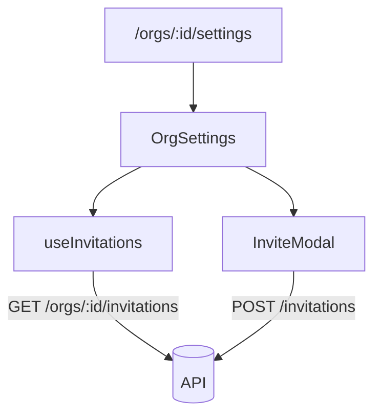

<!-- map: front | sha: <commit this was generated at> | sources: <globs from .claude/map/conventions.md> -->

# Map — Front end

<!-- Generated by /map. Never hand-edit: the next run overwrites everything
     except the Why column, which is carried over verbatim for unchanged
     components. -->

| | |
|---|---|
| **Framework** | <React 19 + Vite / Next 15 app router / Vue 3> |
| **Routing** | <file-system under `app/`, or a router config with its path> |
| **State** | <the libraries actually in use, and what each is used for> |
| **Data fetching** | <TanStack Query / RTK Query / plain fetch, and where the client lives> |
| **Routes** | <n> |
| **Components** | <n> — <n> pages, <n> containers, <n> presentational |

---

## Routes

<!-- Sorted by path. The entry table: a reader starts from a URL they have
     seen, not from a component name. -->

| Route | Page component | Guard | Loads | Why |
|---|---|---|---|---|
| `/orgs/:id/settings` | `OrgSettings` | `admin` | `GET /orgs/:id`, `GET /orgs/:id/invitations` | |
| `/invite/:token` | `AcceptInvite` | none | `POST /invitations/:id/accept` | public by design; the token is the credential |

---

## Components

<!-- Grouped by feature directory, sorted by path within each group. One row per
     component.

     `Kind` is a fixed vocabulary — page | layout | container | presentational |
     hook | store. Nothing else.

     `Owns state` names the state this component is the source of truth for,
     and is empty for anything that only receives props. `Calls` is this map's
     own discovery. `Used by` is transposed by the seam pass: leave it empty
     when generating. -->

### `src/features/invitations/`

| Component | Kind | Owns state | Calls | Used by | Why |
|---|---|---|---|---|---|
| `AcceptInvite` | page | `token`, `status` | `POST /invitations/:id/accept` | | |
| `InviteModal` | container | `form`, `submitting` | `POST /invitations` | | optimistic insert, rolled back on `409` |
| `InviteRow` | presentational | — | — | | |
| `useInvitations` | hook | — | `GET /orgs/:id/invitations` | | |

### `src/components/`

| Component | Kind | Owns state | Calls | Used by | Why |
|---|---|---|---|---|---|
| | | | | | |

---

## Shared state

<!-- Stores, contexts and global hooks: what holds state that outlives a single
     component. `Written by` and `Read by` are transposed by the seam pass.
     Omit the section if this project has none. -->

| Store | Shape | Persisted | Written by | Read by | Why |
|---|---|---|---|---|---|
| `authStore` | `{user, token, org}` | `localStorage` | `LoginForm`, `OrgSwitcher` | | token is also read by the fetch client outside React |

---

## Data flow

<!-- The one diagram for this map: route → page → the components that own state
     → the endpoints hit, for the project's central route only. Capped at ~15
     nodes. Never the component tree — a 200-node graph is unreadable and its
     diff is noise. -->

---

## Unreferenced

<!-- Components with an empty transposed `Used by` and no route of their own.
     Omit when there are none. -->

| Component | Observation |
|---|---|
| `LegacyUserPicker` | not imported anywhere; no route renders it |

---

## Gaps

<!-- Dynamic rendering, components reached only through a registry or a string
     key, anything behind a feature flag — the places where `Used by` cannot be
     trusted. Say so here rather than letting an empty cell mislead. -->

- <what could not be determined, and the reason>
